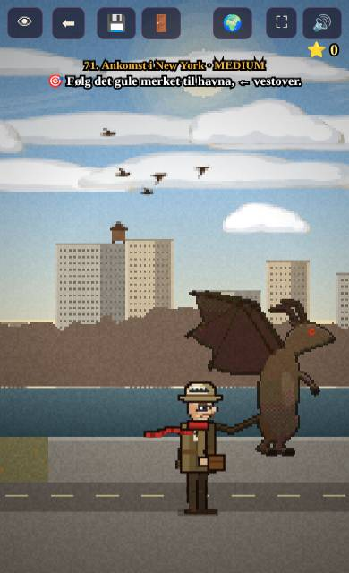
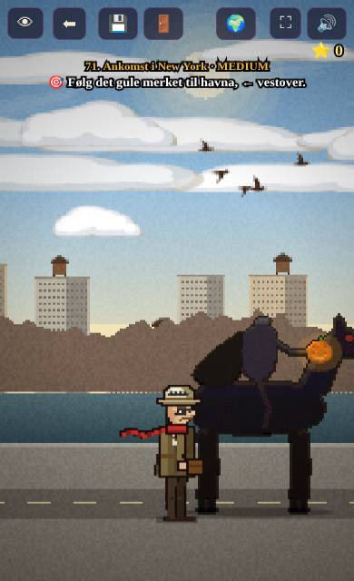
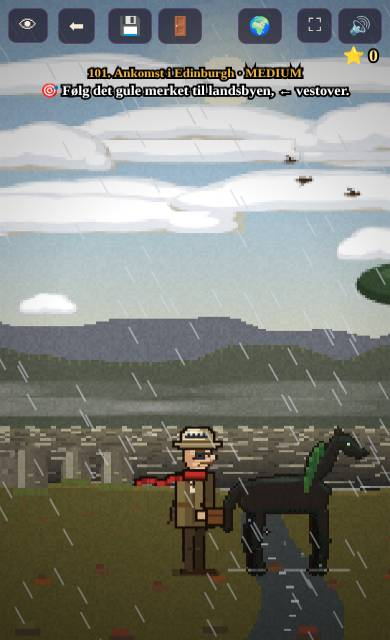
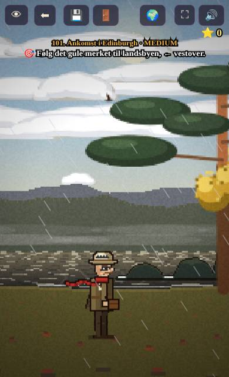
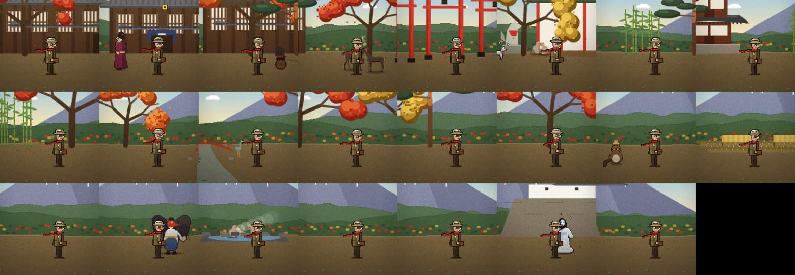
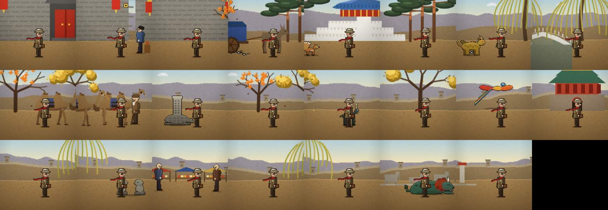
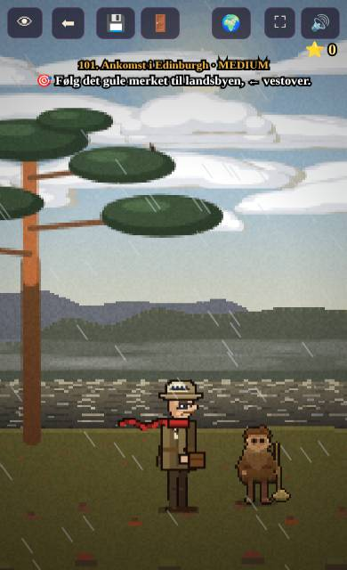
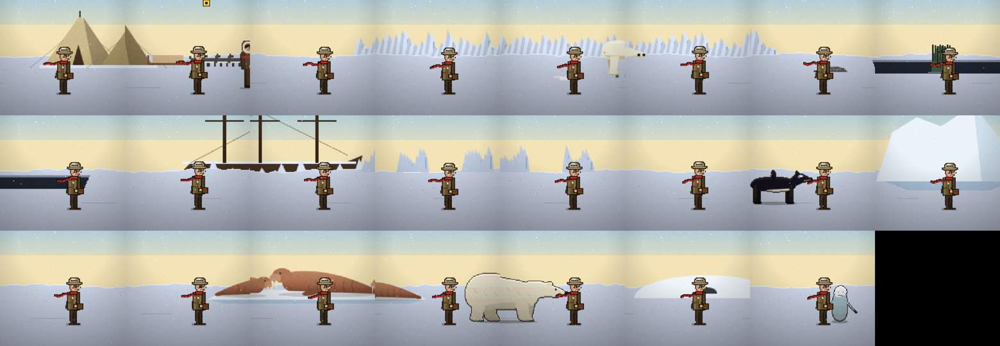

# Uavhengig kontroll – v0.12.3

Kontrollert 8. nov 2026 av en egen kontrolltråd, ikke av byggetråden.

**Slik ble det testet:** Chromium i portrett mobilstørrelse 390×844 med berøring. Koden som ble testet er commit `49040cf` på `main`, altså nøyaktig det GitHub Pages viser. Selve live-adressen er sperret fra testmaskinen, derfor kjørte jeg den samme koden lokalt. Testknappene på forsiden ble brukt for alle 12 land. Natt ble tvunget fram med `HOV=23.5`. Storm ble tvunget fram med `WX.on=1` og `MK[land].wx=()=>1`. Fabeldyrene ble oppsøkt ved å flytte professoren til posisjonene deres.

**Resultat: 9 BESTÅTT · 6 FEIL · 1 ikke kontrollert**

| # | Punkt | Status | Funn |
|---|---|---|---|
| 1 | Trykk i intro og kompassgåten | ✅ BESTÅTT | Hvert trykk gir en synlig ring. Det lysende merket på kartet åpner Kompassrosen. Gåten ble løst med ekte trykk (ytre ring 2×, midtre 1×), og 3 ekstra ⭐ ble lagret.  |
| 2 | Små bølger i rolig vær og store bølger med skum i storm, i alle land | ❌ FEIL | `pWater()` tegner vannet som flate fargebånd med glitter, og det er ingen kode for bølger eller storm der. I New York er havna en flat blå stripe, og den ser lik ut i storm (ikke engang regn). På Loch Ness er det streker i vannet, men storm og rolig vær ser helt like ut. Japan, Kina, Australia, Sør-Afrika, Peru og Mexico har ikke noe hav i det hele tatt.    |
| 3 | Like mange og like synlige fabeldyr som i Norge, og bare ekte sagnvesener | ❌ FEIL | Alle vesenene er ekte sagnvesener. Antallet er ujevnt: Kina 9, Skottland, Japan, Sør-Afrika og Mexico 5, Polen 3, Australia og Peru 4, men Sahara, Dubai og USA bare 2 hver. Nessie vises nå som to pukler i strandkanten, uten hals, og de ligger på land, ikke ute i vannet.  |
| 4 | Proporsjoner mot professoren på 1,75 m (Japan og Kina spesielt) | ✅ BESTÅTT | I Japan og Kina ser hus, porter, folk, kameler, esel og trær riktige ut i forhold til professoren. Merknad: den hodeløse rytterens hest i USA er for høy (manken er over professorens hatt). Hundene i Polen, se punkt 16.   |
| 5 | Mennesker ser ut som mennesker tilpasset landet | ✅ BESTÅTT | Kimono, rickshaw, folk ved markedsbodene i Kina, kamelkaravane, skotsk kvinne og jeger, inuitt med pelshette. Jeg så ingen firkanter. |
| 6 | Plantene står stille når man går (Japan) | ✅ BESTÅTT (kode og bilder) | Tegnekoden for Japan bruker hverken `P.x` eller `camX`, så plantenes svai er ikke koblet til at professoren går. |
| 7 | Dyrene skiller seg fra bakken | ✅ BESTÅTT | Alle dyr og vesener jeg så har mørk kontur og skygge, og står tydelig fram. |
| 8 | Oppgavene er ulike i hvert land | ❌ FEIL | I `CH[26..205].mini` brukes bare 4 minispill i fast rekkefølge: slide → hanoi → cube → lights, 45 ganger hver. Quizene har eget tema per land, men bare 3 formater (skriv/velg/brikker) som går igjen. |
| 9 | Kjøring tar deg til et nytt område | ✅ BESTÅTT | `drive()` kjører nå minst ca. 23 m til et annet navngitt sted, og den sier hvor. Merknad: i den engelske versjonen er replikken blandet: «…we will take a trip to X **og ser oss om**». Avstandene er fortsatt bare innenfor samme stripe på ca. 140 m. |
| 10 | Myke og elegante overganger etter fly og ved dører | ❌ FEIL | Etter hver testknapp vises et mørkt havnekontor i flere sekunder med teksten «🎯 Mekanismen må løses.», som er feil tekst, før landet dukker opp. Dørene bruker iris-overgang (`goRoom` → `irisTo`), og det ser greit ut.  |
| 11 | Professoren klarer å løpe i storm | ✅ BESTÅTT | Med storm tvunget på flyttet han seg 252 enheter på 2,5 s, samme fart som i rolig vær, i 10 av 12 land. |
| 12 | Hint i tre nivåer og synlig tilbakemelding i alle minispill | ⚪ IKKE KONTROLLERT | Dette krever at jeg spiller gjennom minispill, og det rakk jeg ikke denne runden. Neste kontroll tar det. |
| 13 | Naturlig verden: vind i trærne, lys om natta og lignende | ❌ FEIL | Natt fungerer (mørk himmel, nordlys i Polen, lys i vinduene på småbrukene). Storm i Del 2-landene er bare regnstreker, og trærne beveger seg ikke mer. I USA, Sahara-strippen og Dubai skjer det ingenting synlig når «storm» tvinges fram, bortsett fra sandstormen i Sahara. |
| 14 | Fossen i Skottland er stor og imponerende | ✅ BESTÅTT | Foyers-fossen er nå høy og går i to trinn, med dusj. Den fyller hele skjermhøyden. Merknad: vannet forsvinner rett i gresset, uten kulp eller elv.  |
| 15 | Fabeldyrene er gjenkjennelige ut fra sagnene (brownien) | ✅ BESTÅTT | Brownien er nå en liten lodden mann med feiekost, slik han beskrives i sagnene (han gjør husarbeid om natta). Brownien er et ekte skotsk sagnvesen.  |
| 16 | Polen: hundene ser ut som hunder og sleden som en slede, polfolket er ikke klosser, og det gule merket står ikke på himmelen | ❌ FEIL | Hundene er fortsatt grå strekfigurer, og sleden er en flat brun planke. Det gule merket svever høyt oppe på himmelen over leiren. Inuitten med pelshette ser bra ut.   |

Panorama av Skottland: 

## Grunnlinje v0.12.2 (før v0.12.3)
Dette ble rettet mellom v0.12.2 og v0.12.3: fossen (var en tynn hvit stolpe), brownien (var en brun klump), Nessie (var usynlig), menneskene i Kina og Japan, og flere fabeldyr i Kina (fra 5 til 9).
