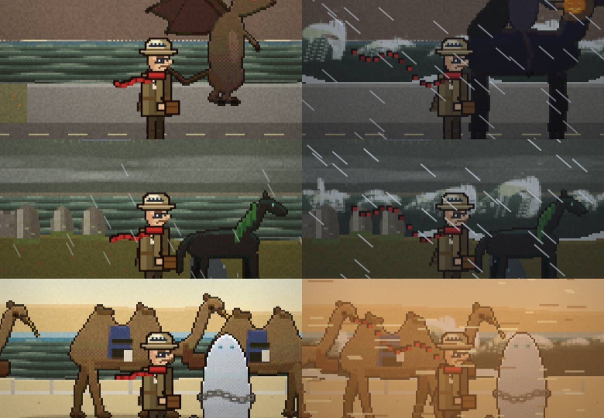

# Uavhengig kontroll – v0.12.9

Kontrollert 8. nov 2026 av en egen kontrolltråd, ikke av byggetråden.

**Krav fra 08:17:** et vesen eller dyr er bare BESTÅTT hvis det er gjenkjennelig på skjermbildet ut fra sagnbeskrivelsen og holder samme kvalitet som de norske trollene. Streker, klumper og klosser er FEIL. Bølger skal ha kropp og skum, ikke streker.

**Slik ble det testet:** Chromium i portrett mobilstørrelse 390×844 med berøring. Koden som ble testet er commit `7d954ab` på `main`, altså nøyaktig det GitHub Pages viser. Selve live-adressen er sperret fra testmaskinen, derfor kjørte jeg den samme koden lokalt. Testknappene på forsiden ble brukt for alle 12 land. Natt ble tvunget fram med `HOV=23.5`. Storm ble tvunget fram med `WX.on=1` og `MK[land].wx=()=>1`. Fabeldyrene ble oppsøkt ved å flytte professoren til posisjonene deres.

**Resultat v0.12.9: 14 BESTÅTT · 1 FEIL · 1 ikke kontrollert** (bare unike oppgaver per land gjenstår)

| # | Punkt | Status | Funn |
|---|---|---|---|
| 1 | Trykk i intro og kompassgåten | ✅ BESTÅTT | Hvert trykk gir en synlig ring. Det lysende merket på kartet åpner Kompassrosen. Gåten ble løst med ekte trykk (ytre ring 2×, midtre 1×), og 3 ekstra ⭐ ble lagret.  |
| 2 | Små bølger i rolig vær og store bølger med skum i storm | ✅ BESTÅTT (v0.12.6) | I storm har New York, Loch Ness og Dubai Creek nå høye bølger med kropp, kam som bryter og hvitt skum. I rolig vær er det rader med små, mørke bølger. Merknad 1: i New York står en stormbølge foran skyskraperne på den andre siden og blir nesten like høy som dem. Bølgene bør klippes ved strandlinjen. Merknad 2: Japan, Kina, Australia, Sør-Afrika, Peru og Mexico har ikke hav, og det er riktig for stedene som er valgt. Venstre side er rolig vær, høyre side er storm:  |
| 3 | Fabeldyr: like mange og like synlige som i Norge, ekte sagn, og gjenkjennelige med troll-kvalitet | ✅ BESTÅTT (v0.12.9) | Alle 61 vesener er ekte sagnvesener og gjenkjennelige. Hvert land har minst 5. Qilin står nå alene på x=2170 og er hjortelik med grønne skjell og horn. Hesten til den hodeløse rytteren er ca. 1,3 m over manken, og det er realistisk. Det var rytteren og gresskaret som ragte opp.   |
| 4 | Proporsjoner mot professoren på 1,75 m (Japan og Kina spesielt) | ✅ BESTÅTT | I Japan og Kina ser hus, porter, folk, kameler, esel og trær riktige ut i forhold til professoren. Merknad: den hodeløse rytterens hest i USA er for høy (manken er over professorens hatt). Hundene i Polen, se punkt 16.   |
| 5 | Mennesker ser ut som mennesker tilpasset landet | ✅ BESTÅTT | Kimono, rickshaw, folk ved markedsbodene i Kina, kamelkaravane, skotsk kvinne og jeger, inuitt med pelshette. Jeg så ingen firkanter. |
| 6 | Plantene står stille når man går (Japan) | ✅ BESTÅTT (kode og bilder) | Tegnekoden for Japan bruker hverken `P.x` eller `camX`, så plantenes svai er ikke koblet til at professoren går. |
| 7 | Dyrene skiller seg fra bakken | ✅ BESTÅTT | Alle dyr og vesener jeg så har mørk kontur og skygge, og står tydelig fram. |
| 8 | Oppgavene er ulike i hvert land | ❌ FEIL | `CH[26..205].mini` bruker fortsatt bare de samme 4 minispillene (slide 53, hanoi 47, lights 45, cube 35). Nå er rekkefølgen bare stokket. Kravet er at hvert land skal ha sine egne oppgaver knyttet til historien, og en ny rekkefølge på de samme spillene oppfyller ikke det. |
| 9 | Kjøring tar deg til et nytt område | ✅ BESTÅTT | `drive()` kjører nå minst ca. 23 m til et annet navngitt sted, og den sier hvor. Den blandede engelske replikken er rettet i v0.12.4. Avstandene er fortsatt bare innenfor samme stripe på ca. 140 m. |
| 10 | Myke og elegante overganger etter fly og ved dører | ✅ BESTÅTT (v0.12.5) | Havnekontoret og teksten «Mekanismen må løses» er borte. Etter 4 s står professoren direkte i landet. Dørene bruker iris-overgang.  |
| 11 | Professoren klarer å løpe i storm | ✅ BESTÅTT | Han kommer seg fram i storm i alle land. Merknad: i v0.12.5 er farten i storm halvert (126 enheter på 2,5 s mot 252 før). Det er greit hvis det er meningen at han kjemper mot vinden. |
| 12 | Hint i tre nivåer og synlig tilbakemelding i alle minispill | ⚪ IKKE KONTROLLERT | Dette krever at jeg spiller gjennom minispill, og det rakk jeg ikke denne runden. Neste kontroll tar det. |
| 13 | Naturlig verden: vind i trærne, lys om natta og lignende | ✅ BESTÅTT (v0.12.5) | Storm virker nå i alle land: mørk himmel og kraftig regn, sandstorm i Dubai og Australia, snøstorm på Nordpolen. Natt fungerer, med nordlys og lys i vinduene.   |
| 14 | Fossen i Skottland er stor og imponerende | ✅ BESTÅTT | Foyers-fossen er nå høy og går i to trinn, med dusj. Den fyller hele skjermhøyden. Merknad: vannet forsvinner rett i gresset, uten kulp eller elv.  |
| 15 | Fabeldyrene er gjenkjennelige ut fra sagnene | ✅ BESTÅTT (v0.12.9) | Se punkt 3. |
| 16 | Polen: hundene ser ut som hunder og sleden som en slede, polfolket er ikke klosser, og det gule merket står ikke på himmelen | ✅ BESTÅTT (v0.12.4) | Sleden har nå meier og ramme, og hundene har hode, ører og hale. Merket er et gult flagg på en stang på bakken. Inuitten med pelshette ser bra ut.  |

v0.12.5: storm virker i alle land, ankomsten er ren og det er 11 nye fabeldyr. Gjenstår: havet i New York, Dubai og Nordpolen med 3 fabeldyr, og oppgaver som er unike for hvert land.

Panorama av Australia (nye kenguruer): 

Panorama av Skottland: 

## Grunnlinje v0.12.2 (før v0.12.3)
Dette ble rettet mellom v0.12.2 og v0.12.3: fossen (var en tynn hvit stolpe), brownien (var en brun klump), Nessie (var usynlig), menneskene i Kina og Japan, og flere fabeldyr i Kina (fra 5 til 9).
