# Uavhengig kontroll – v0.16.4 beta

Kontrollert 8. nov 2026 av en egen kontrolltråd, ikke av byggetråden.

**Krav fra 08:17:** et vesen eller dyr er bare BESTÅTT hvis det er gjenkjennelig på skjermbildet ut fra sagnbeskrivelsen og holder samme kvalitet som de norske trollene. Streker, klumper og klosser er FEIL. Bølger skal ha kropp og skum, ikke streker.

**Slik ble det testet:** Chromium i portrett mobilstørrelse 390×844 med berøring. Koden som ble testet er commit `578cea2` på `main`, altså nøyaktig det GitHub Pages viser. Selve live-adressen er sperret fra testmaskinen, derfor kjørte jeg den samme koden lokalt. Testknappene er fjernet i 0.16.0 beta, så jeg hopper til kapitlene med lagringskoder. Natt ble tvunget fram med `HOV=23.5`. Storm ble tvunget fram med `WX.on=1` og `MK[land].wx=()=>1`. Fabeldyrene ble oppsøkt ved å flytte professoren til posisjonene deres.

**Resultat v0.16.4 beta: 19 BESTÅTT · 1 FEIL.** Målkortene og ferjelappene er rettet. Feilen er to av de nye, større oppgavevinduene: i luopan-kompasset og leirbitene ligger tekst og knapper oppå hverandre.

v0.15.2 (ny musikk): alle 47 musikkspor dekodes i nettleseren og har lyd (24 dag/natt, 12 ankomstmotiv, 6 reisespor og 5 gamle). Reisesporene finnes for alle kjøretøy som brukes (fly, båt og bil). Ankomstmotivet startet i Norge. Ingen sidefeil og ingen manglende filer. Jeg har ikke lyttet, så jeg har ikke vurdert hvordan musikken låter.

| # | Punkt | Status | Funn |
|---|---|---|---|
| 1 | Trykk i intro og kompassgåten | ✅ BESTÅTT | Hvert trykk gir en synlig ring. Det lysende merket på kartet åpner Kompassrosen. Gåten ble løst med ekte trykk (ytre ring 2×, midtre 1×), og 3 ekstra ⭐ ble lagret. 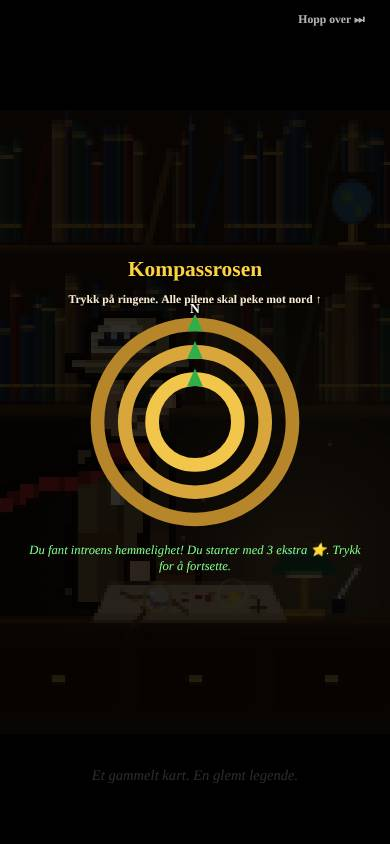 |
| 2 | Naturlige bølger i alle land: flate, små og store om hverandre, i et vakkert kaos | ✅ BESTÅTT (v0.14.2) | Testet på Loch Ness, i Bodø og i New York, i rolig vær og i storm, med tre bilder per tilstand 0,3 s fra hverandre. Det er ingen sideveis glidning (målt forskyvning 0). I rolig vær er overflaten nå et uregelmessig mønster av korte bølger i lyse og mørke grønntoner, i ulike størrelser. I storm er det brytende hvite kammer med sprut i ulike høyder. Merknad: i Bodø går noen stormkammer opp over strandlinjen på den andre siden. Venstre er rolig vær, høyre er storm, og radene er Loch Ness, Bodø og New York: 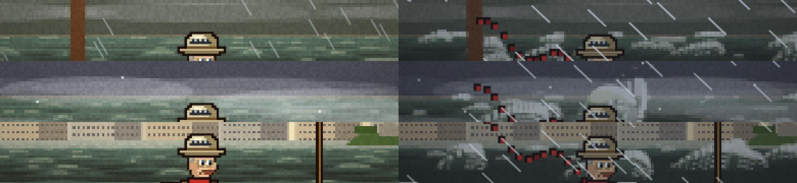 |
| 3 | Fabeldyr: like mange og like synlige som i Norge, ekte sagn, og gjenkjennelige med troll-kvalitet | ✅ BESTÅTT (v0.12.9) | Alle 61 vesener er ekte sagnvesener og gjenkjennelige. Hvert land har minst 5. Qilin står nå alene på x=2170 og er hjortelik med grønne skjell og horn. Hesten til den hodeløse rytteren er ca. 1,3 m over manken, og det er realistisk. Det var rytteren og gresskaret som ragte opp. 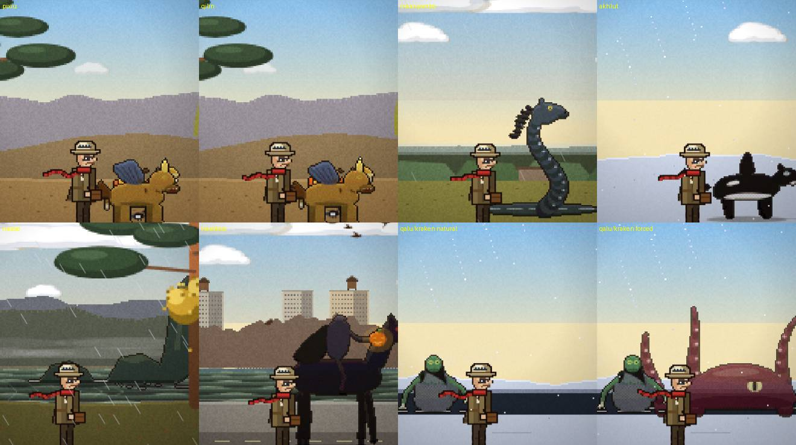 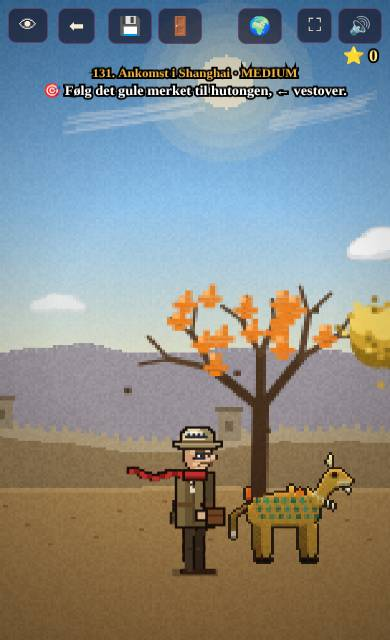 |
| 4 | Proporsjoner mot professoren på 1,75 m: hus, dyr, kjøretøy og trær | ✅ BESTÅTT (v0.14.1) | Toget i Lima: vognen er ca. 2,3 × professoren (ca. 4 m), og det er riktig. Hvalrossene på Nordpolen har støttenner og luffer, er ca. 3 m lange og ligger lavere enn professoren. Fyret i Bodø rager langt over toppen av skjermen, over 4 × professoren, altså 20 m eller mer. Japan og Kina er fortsatt OK. 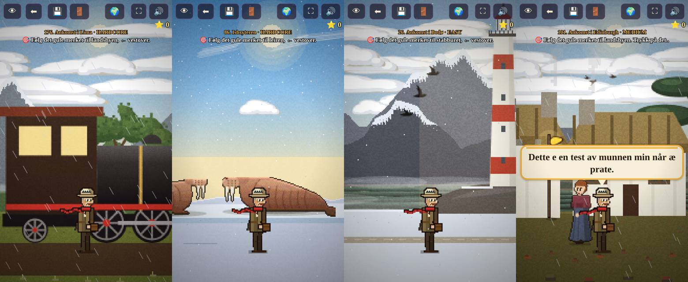 |
| 5 | Mennesker ser ut som mennesker tilpasset landet | ✅ BESTÅTT | Kimono, rickshaw, folk ved markedsbodene i Kina, kamelkaravane, skotsk kvinne og jeger, inuitt med pelshette. Jeg så ingen firkanter. |
| 6 | Plantene står stille når man går (Japan) | ✅ BESTÅTT (kode og bilder) | Tegnekoden for Japan bruker hverken `P.x` eller `camX`, så plantenes svai er ikke koblet til at professoren går. |
| 7 | Dyrene skiller seg fra bakken | ✅ BESTÅTT | Alle dyr og vesener jeg så har mørk kontur og skygge, og står tydelig fram. |
| 8 | Oppgavene er ulike i hvert land | ✅ BESTÅTT (v0.16.1, alle 5 land i betaen) | **Norge (26–40) BESTÅTT (v0.16.1):** 6 egne oppgaver: strikk (26, 35, 36), malstrøm (27, 33, 38), tran (28, 34), ferje (29), fele (30, 32, 40) og runer (31, 37, 39). Andre gang er oppgaven vanskeligere (strikk speiles to veier, malstrømmen går fra 5×5 til 6×6, runeordet fra 4 til 5 tegn). Tips i tre nivåer er testet i alle kapitlene unntatt 33, og nivå 3 gir et konkret neste trekk. Alle 15 faktalinjene er sjekket og stemmer (Bodø 1816, Saltstraumen 400 mill. m³, Trollfjordslaget 1890, Borg 83 m og funnet 1981, Ofotbanen 1902, Hammerfest 1891, Nordkapp 307 m, Svalbard 1925, Hurtigruten 1893 og de andre). I v0.16.3 er fela byttet med strikk i kapittel 36, og målkortet for runene sier at dette er den eldre runerekka fra før vikingtida. 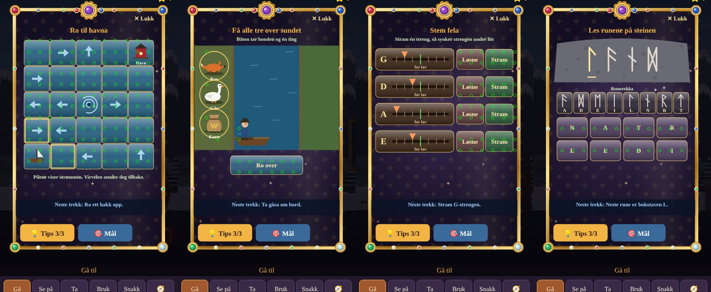 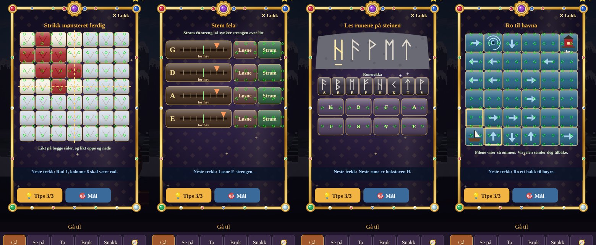 **Sahara (41–55) BESTÅTT (v0.16.0):** 15 ulike rom og 6 egne oppgaver: foggara (41, 44, 49), sanddyner (42, 48, 53), stjernene (43, 50), saltlast (45, 46, 51), klippemalerier (47, 55) og magisk kvadrat (52, 54). Andre gang er oppgaven vanskeligere: dynekartet går fra 4×5 til 5×6 ruter, det magiske kvadratet fra 3×3 til 4×4, og klippemaleriene fra 4 til 5 bilder. Tipsene er testet i 41, 42, 43, 45, 47, 52, 53, 54 og 55. Nivå 3 gir et konkret neste trekk, og jeg regnet etter at tallene i begge de magiske kvadratene stemmer. Rekkefølgen på klippemaleriene stemmer med Tassili (ville dyr, rundhoder, kveg, hest og vogn, kamel). Merknad: tipset i foggara lyder «Snu ruta i rad 1, kolonne 1 1 gang.», og det er tungt å lese. 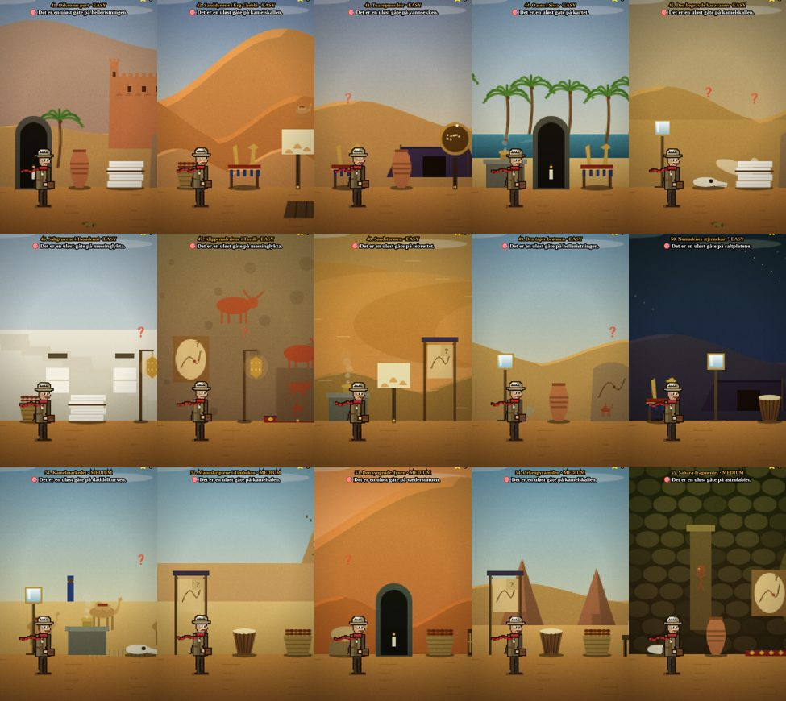 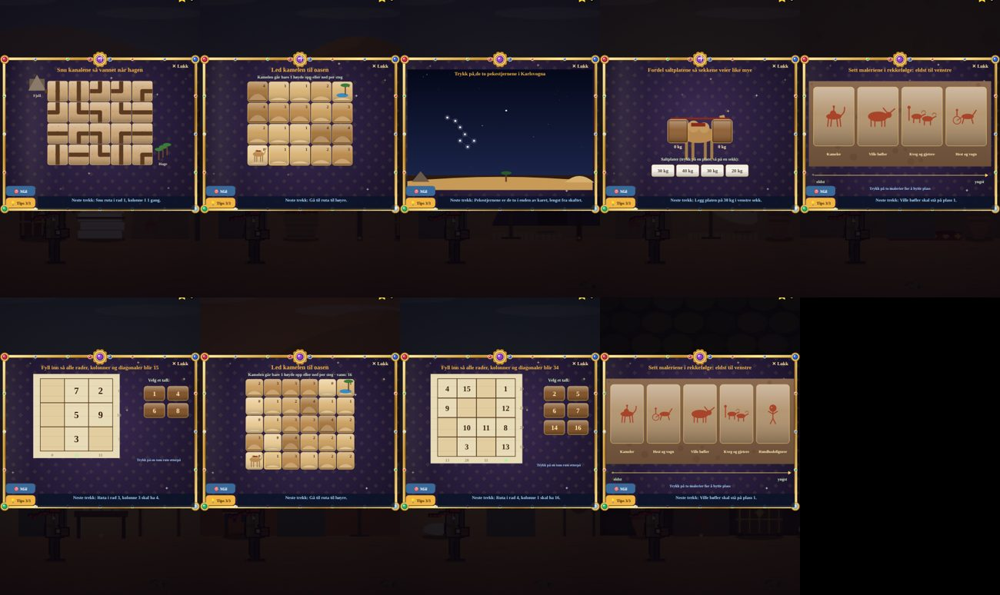 **Skottland (101–115), Japan (116–130) og Kina (131–145) BESTÅTT** siden v0.13.0, v0.14.0 og v0.15.0, med 6 egne oppgaver hver. I v0.15.1 veksler kartet mellom kartstein, kartrull og kartbutikk i Kina, og mellom oppslagstavle og kunngjøringstavle i Japan. De sju landene utenfor betaen er skjult og ikke vurdert her. 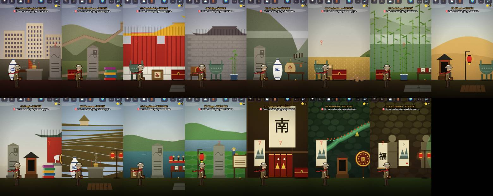 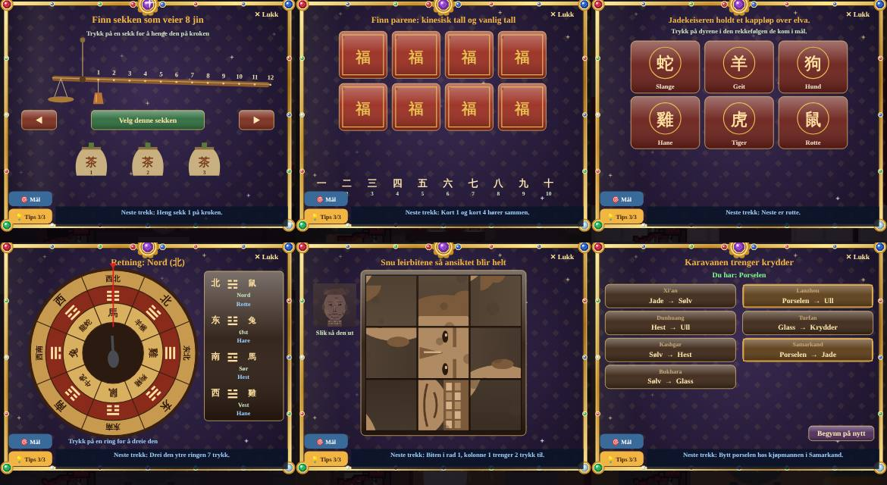 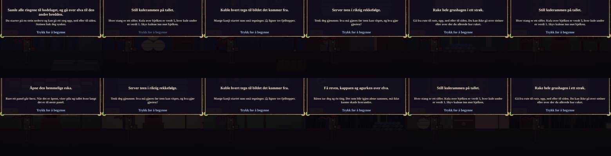 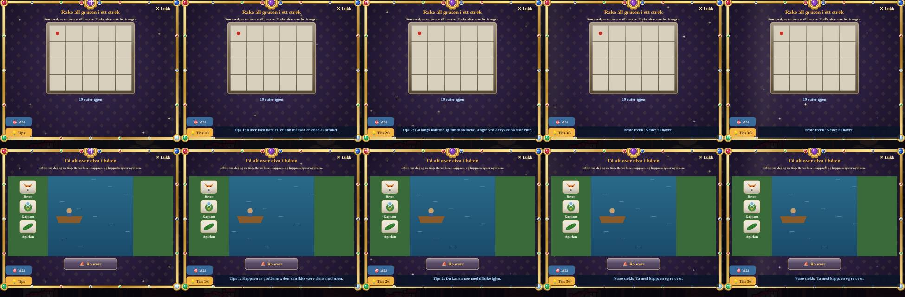 |
| 9 | Kjøring tar deg til et nytt område | ✅ BESTÅTT | `drive()` kjører nå minst ca. 23 m til et annet navngitt sted, og den sier hvor. Den blandede engelske replikken er rettet i v0.12.4. Avstandene er fortsatt bare innenfor samme stripe på ca. 140 m. |
| 10 | Myke og elegante overganger etter fly og ved dører | ✅ BESTÅTT (v0.12.5) | Havnekontoret og teksten «Mekanismen må løses» er borte. Etter 4 s står professoren direkte i landet. Dørene bruker iris-overgang. 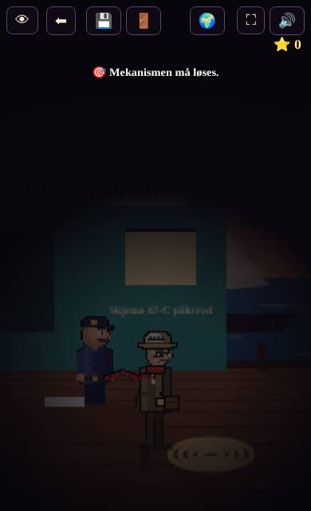 |
| 11 | Professoren klarer å løpe i storm | ✅ BESTÅTT | Han kommer seg fram i storm i alle land. Merknad: i v0.12.5 er farten i storm halvert (126 enheter på 2,5 s mot 252 før). Det er greit hvis det er meningen at han kjemper mot vinden. |
| 12 | Hint i tre nivåer og synlig tilbakemelding i alle minispill | ✅ BESTÅTT | Testet med ekte trykk i piktisk stein (101), Clava-røys (104) og sluser (108). Hvert trykk på 💡 Tips gir neste nivå (1/3, 2/3, 3/3). Nivå 3 sier det konkrete neste trekket («Felt 1 skal være speilet», «Velg des.», «Trykk Flytt båten»), og det stemmer med oppgaven. Måltavla vises først. Et trykk på et felt bytter symbolet der det ble trykket, også med to rader i sekken. Tips i de generiske minispillene er ikke testet. |
| 13 | Naturlig verden: vind i trærne, lys om natta og lignende | ✅ BESTÅTT (v0.12.5) | Storm virker nå i alle land: mørk himmel og kraftig regn, sandstorm i Dubai og Australia, snøstorm på Nordpolen. Natt fungerer, med nordlys og lys i vinduene. 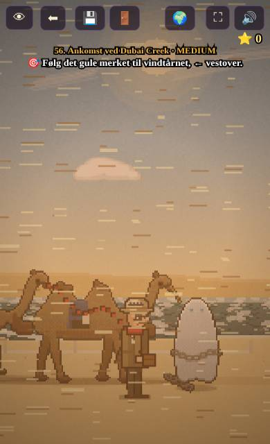 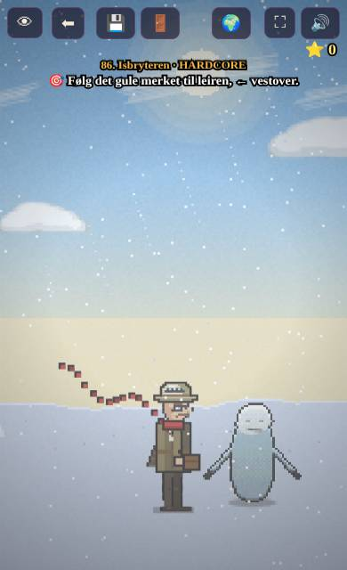 |
| 14 | Fossen i Skottland er stor og imponerende | ✅ BESTÅTT | Foyers-fossen er nå høy og går i to trinn, med dusj. Den fyller hele skjermhøyden. Merknad: vannet forsvinner rett i gresset, uten kulp eller elv. 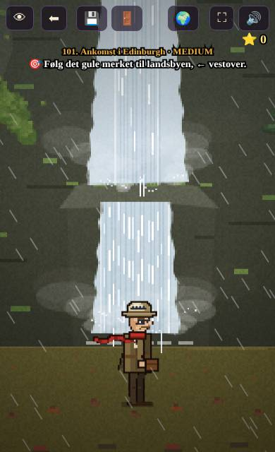 |
| 15 | Fabeldyrene er gjenkjennelige ut fra sagnene | ✅ BESTÅTT (v0.12.9) | Se punkt 3. |
| 16 | Polen: hundene ser ut som hunder og sleden som en slede, polfolket er ikke klosser, og det gule merket står ikke på himmelen | ✅ BESTÅTT (v0.12.4) | Sleden har nå meier og ramme, og hundene har hode, ører og hale. Merket er et gult flagg på en stang på bakken. Inuitten med pelshette ser bra ut. 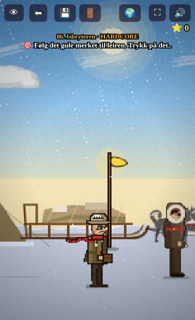 |
| 17 | Egen kulisse per kapittel med ting som hører til stedet | ✅ BESTÅTT (v0.16.3) | **Norge (26–40) BESTÅTT (v0.16.3):** alle 15 kapitlene har eget bakteppe: rorbuer og brygge i Bodø, Saltstraumen, fiskevær i Lofoten, Trollfjorden, kirka på Borg, Narvik, Senja-tindene, Tromsø, nordlys, lavvo på vidda, hjell i Hammerfest, Nordkapp, Svalbard og en isgrotte. Tingene er norske: anker, fiskegarn, hjell, hvalbein, rosemalt kiste, spark, ski, pulk, melkespann, kaffekjele, varde, bautastein og reinsgevir. Statuen, skjelettet og bokhylla er borte. Merknad: steinnisjen med lys og sjøkartet på tavle går igjen i de fleste rommene. 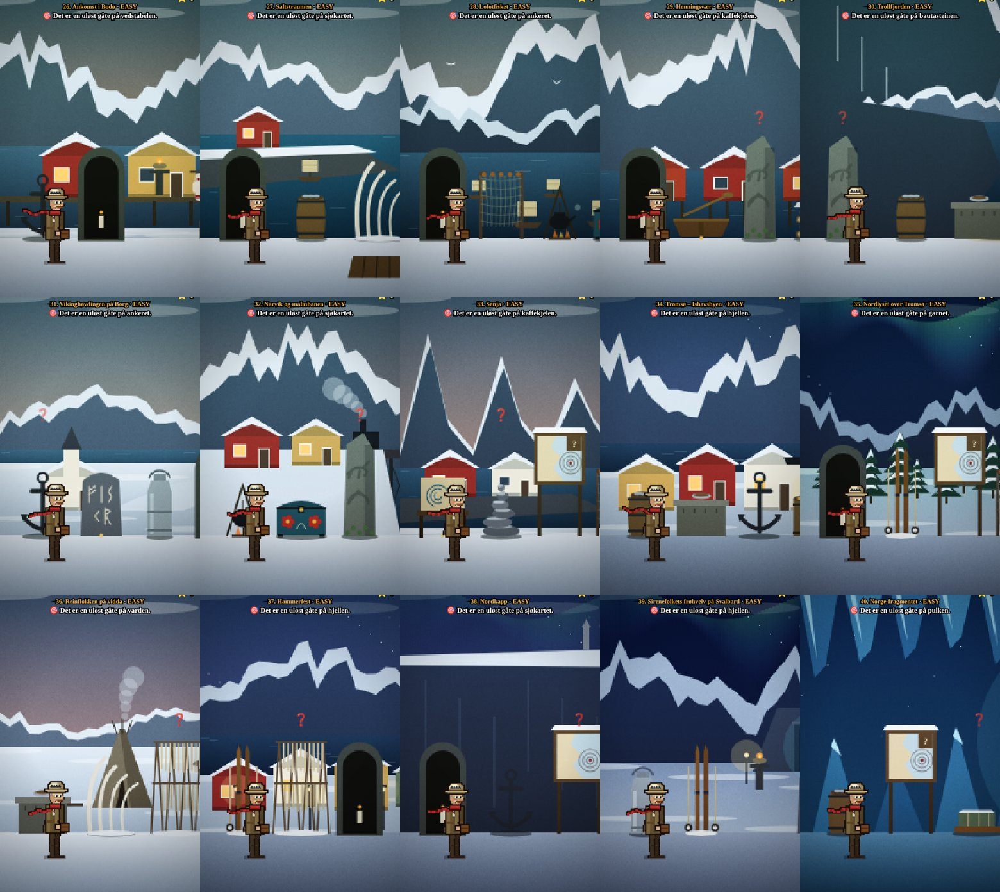 **Skottland og Japan BESTÅTT (v0.14.0):** Skjelettene og de felles statuene og tønnene er borte. Skottland har skjold og sverd, klanvåpen, keltisk kors, torvkurv, hummerteine, fiskegarn og rokk. Japan har revestatue, Jizō, steinlykt, taiko-tromme, tansu-kommode, papirparasoll, bonsai og vannkum. Merknad: oppslagstavla med «?» går igjen i mange rom i begge land. 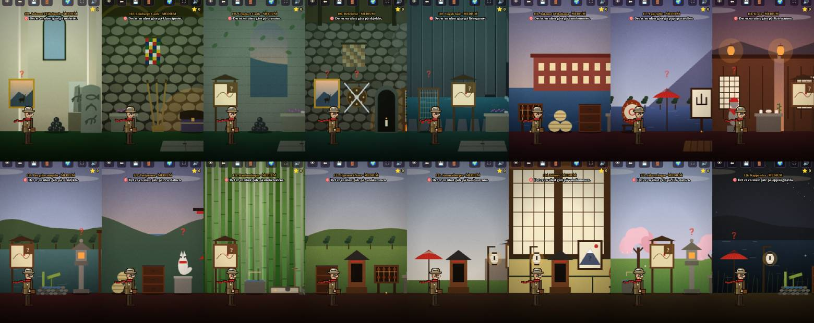 |
| 18 | Alle personer, også professoren, har ordentlige ansikter | ✅ BESTÅTT (v0.14.1) | Kvinnen i Skottland, stasjonsmannen i Australia og professoren har nå to øyne med iris, bryn, nese og munn. Professoren har også briller og bart. Det er tydelig også ved denne pikselstørrelsen. Jeg målte ikke om munnen beveger seg når han snakker. 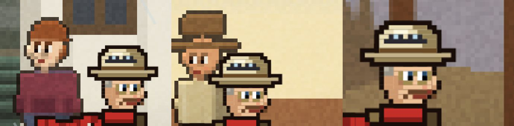 |
| 19 | Beta: forside, klode og overganger | ✅ BESTÅTT (v0.16.1) | Forsiden har ingen testknapper, og versjonen står som «0.16.2 beta». Kloden viser bare Karibia, Norge, Sahara, Skottland, Japan og Kina. Etter kapittel 55 kommer kortet «Start kapittel 101: Ankomst i Edinburgh». Etter kapittel 145 kommer «Betaen er fullført!», og koden på kortet er nå KAP145, ikke KAP146. Kamelene i Sahara og Dubai er hele. 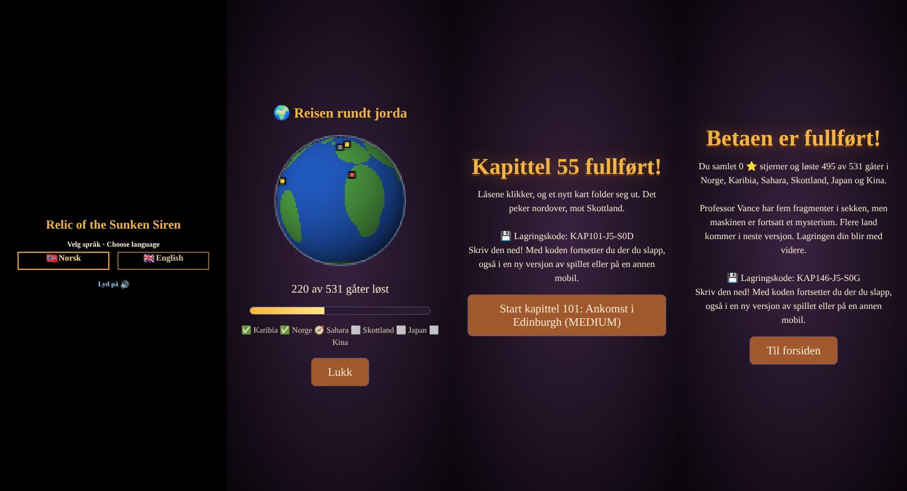 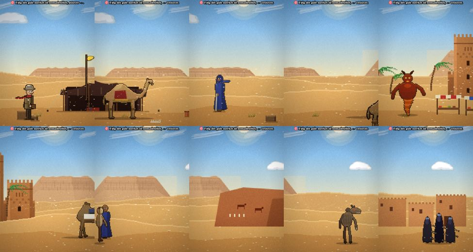 |
| 20 | Større oppgavevindu på stående mobil | ❌ FEIL (to oppgaver, v0.16.4) | **FEIL 1, luopan (134):** Mål-knappen dekker starten av teksten «Trykk på en ring for å dreie den», kompasskiva går ned bak knappen, og den røde nåla går opp i overskriften. Det er likt på 390 og 412 px. **FEIL 2, leirbitene (136):** «✕ Lukk» ligger oppå slutten av overskriften «Snu leirbitene så ansiktet blir helt». 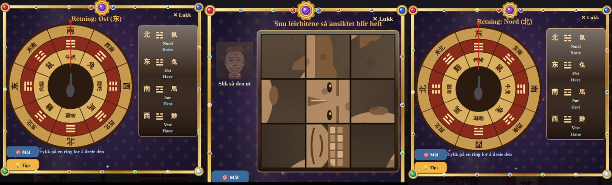 **Rettet i v0.16.4:** målkortene for fele og runer overlapper ikke lenger, og lappene «Rev», «Gås» og «Korn» er lesbare. 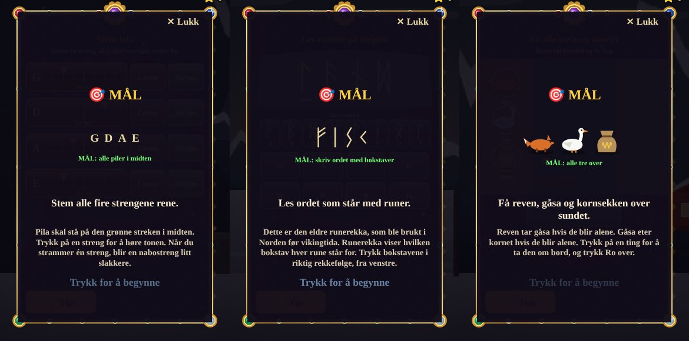 **Brede oppgaver med ny ramme (v0.16.4):** foggara, magisk kvadrat, sekkepipe, kanji, teseremoni, hemmelig eske, bismer, kinesiske tall og dyrekrets er testet på begge størrelser med trykkrutenett. Innholdet ligger inni rammen, og trykkene treffer. Merknader: Tips-knappen i kinesiske tall ligger helt nede på rammekanten, og tipslinja i teseremonien står tett mot bunnen. Ikke testet: rubik og hanoi, som bare finnes i Karibia. 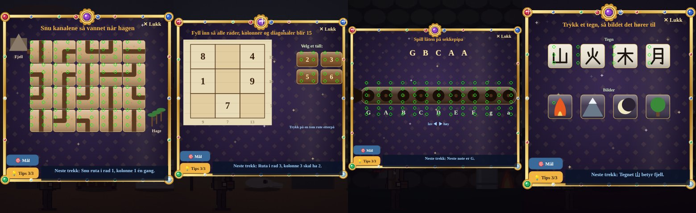  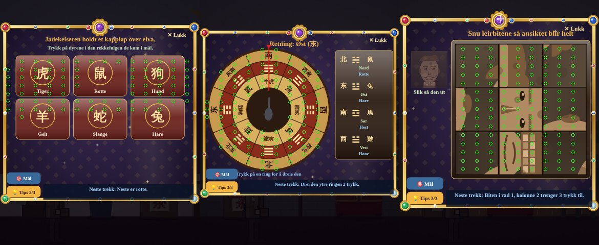 **Høyt vindu:** testet på 390×844 og 412×915 i v0.16.2: strikk, malstrøm, tran, ferje, fele, runer, dyner, piktisk stein, tartan, røys, kelpie, sluser, soroban og zen-hage. Vinduet fyller bredden, innholdet ligger inni rammen, og tipslinja dekker ingenting. Et trykkrutenett på ca. 200 punkter per oppgave treffer brikkene og knappene (grønne ringer på bildene). Alle 15 Norge-kapitlene er kjørt på nytt i v0.16.3 på 390×844. Ikke testet: lights og slide, som bare finnes i Karibia. Merknad: tartanen i kapittel 103 ble løst med ett eneste trykk på tråd 1 i testen min. 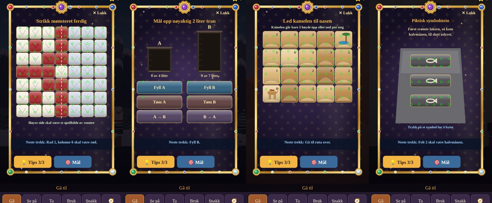 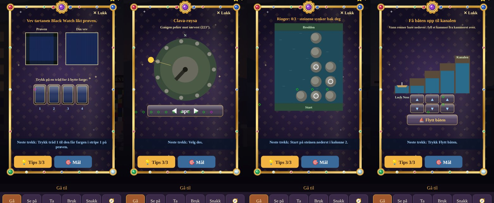 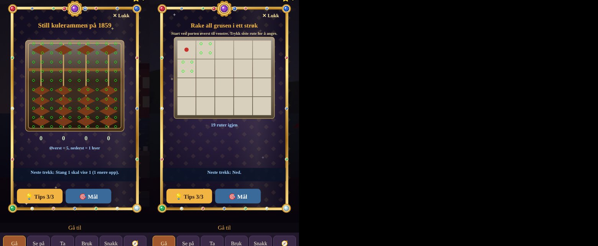 |

v0.12.5: storm virker i alle land, ankomsten er ren og det er 11 nye fabeldyr. Gjenstår: havet i New York, Dubai og Nordpolen med 3 fabeldyr, og oppgaver som er unike for hvert land.

Panorama av Australia (nye kenguruer): 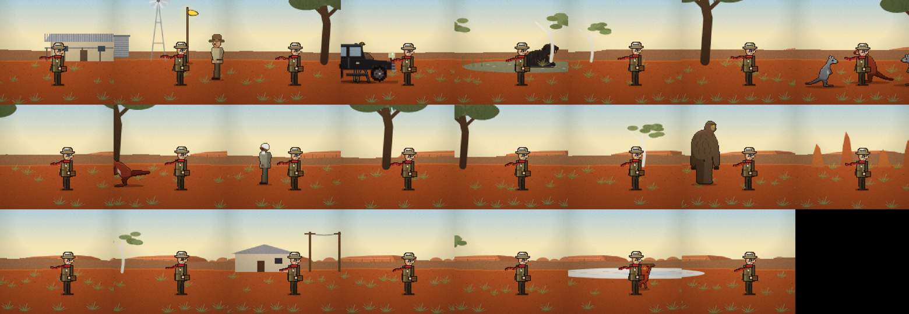

Panorama av Skottland: 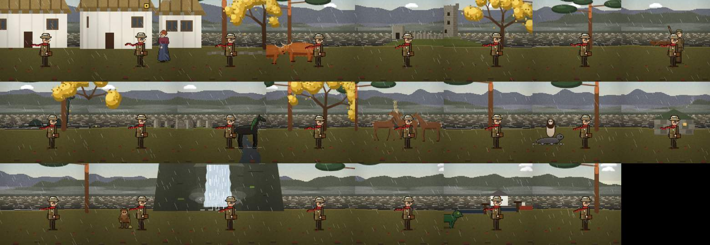

## Grunnlinje v0.12.2 (før v0.12.3)
Dette ble rettet mellom v0.12.2 og v0.12.3: fossen (var en tynn hvit stolpe), brownien (var en brun klump), Nessie (var usynlig), menneskene i Kina og Japan, og flere fabeldyr i Kina (fra 5 til 9).
